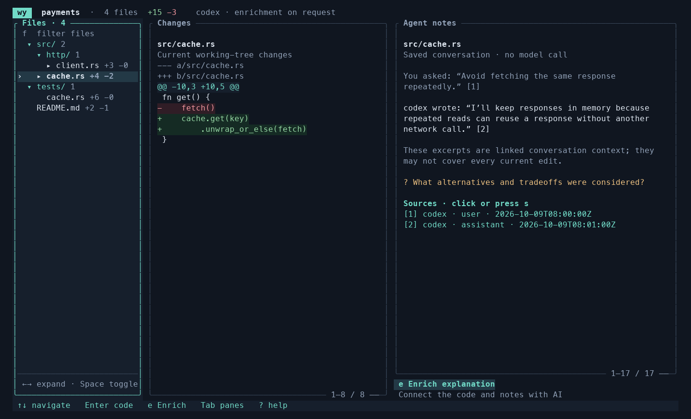

<div align="center">


# wy

### Form a judgment about AI-written changes in a domain you don't know—before you commit them.

[](#status)
[](#how-it-works)
[](#what-the-evidence-means)
[](LICENSE)

</div>

You handed a problem to an agent because you couldn't solve it yourself. Now it has
changed 40 files, and the consequential choices were made without you. wy turns the
**uncommitted diff** into the questions you'd need to be able to answer to accept
it—and shows you which of them the agent's own record actually answers.

Two screens on the same hunks:

- **Plan**: the first screen. Four boxes—**What changed** (plain-language groups),
  **What to worry about** (questions a domain expert would ask, plus files with no
  record of why), **Was it tested**, and **Progress**. Every row opens its evidence.
  A worry carries what the agent chose, what it **said** (an exact quote, or an honest
  **unknown**), the code with markers, where to look yourself, and your verdict:
  accept · push back · unsure.
- **Steps**: the audit trail. The captured session as intent-sized steps, each with
  Why (verbatim or "no reason given"), Check, Gap, and the worries it raises; the
  original conversation is one link deeper.

Your verdicts persist and export as a review in your voice—push-backs first, so they
paste straight back to the agent as the next instruction. That loop is the point:
judgment formed → fed back → better next iteration, until you can ask the questions
yourself before the agent runs.

It imports existing local **Codex, Claude Code, pi, and OpenCode** history. No
recorder has to be running first. Attribution is a textual match between a hunk and
a captured edit, or nothing—wy never assigns today's diff to a session because the
tree happens to be dirty. Missing evidence stays missing; a nearby message is not a
proven reason. Nothing calls a model until you open the **?** row on the plan.



*The screenshot illustrates the secondary file/history reader. The default screen is the plan.*

## Get started

Needs Rust 1.88+, Git and a C toolchain.

```bash
cargo install --git https://github.com/grandimam/wy --locked wy-code
cd /path/to/your/repo
wy
```

- **Plan (`p`):** the opening screen. **What changed** lists what the agent did, in plain words, one row per change group. **What to worry about** lists the questions you need to be able to answer (opening the `?` row forms them with your reasoning CLI—explicitly, never on its own) and the files no captured edit explains. **Was it tested** is one line of fact and one of what was not. **Progress** says what you have read and decided. `Enter` on any row opens its evidence; in a worry `y`/`n`/`m` record accept / push back / unsure and `i` adds a note.
- **Steps (`t`):** one bordered box per step, in order: **Why** in the agent's own words or "no reason given", **Check** (build/test runs, fail → fixed), **Gap** (shell writes, unconfirmed captures), **Plan** (the worries it raises). `Enter` opens the step with its hunks and a link to the original conversation. **Not explained by this session** lists hunks no captured edit matches.
- **Beneath Steps:** the original transcript (`o`), the session decision brief (`d`), captured-edit comparison with current code, and commit history. These are drill-downs, not sections.
- **Evidence is chosen from the diff.** Every captured session whose edit text matches a hunk counts, newest first, bounded to four; the plan's evidence line says "1 session, …" or "N sessions explain X of Y files". Open it to see which, to hand-pick a different one, or to let the diff choose again. No list to scan, no guessing by date.
- **Refresh (`r`):** recapture history offline, keeping the selected session when available.

**Plan / Steps** is the whole navigation—one row at the top, full width for the content. Original conversations are a final drill-down, not a separate History section. **As implemented** shows captured code, including explicit execution and truncation gaps. A clean Git tree does not erase session work. No history means no session reconstruction—not an automatic fallback to today's diff.

**Ctrl+Left/Right** switches sections · **s** selects links · **?** opens help.

**Copy text:** drag over text in the main pane; releasing the mouse copies the
selection. Scroll while dragging, or hold the pointer below the pane to select
more. Navigation panes are excluded—no keyboard mode switch needed.

## Understand history and decisions

| Command | What it shows |
|---|---|
| `/plan` · `/steps` | The two screens (also **p** / **t**) |
| `/plan ask` | Explicitly form the worries (same as opening the `?` row) |
| `/transcript` | The original conversation for the selected session (also **o**) |
| `/coverage` | Per-tool discovery/capture counts, exclusions, warnings, and unmatched hunks |
| `/sessions` | Session picker; selecting one scopes both decisions and implementation flow |
| `/timeline [FILE:SYMBOL]` | Chronological turns associated with a file or explicitly mentioned symbol |
| `/decisions` | Selected-session decisions (also **d**) |
| `/changes` | Working-tree changes, explicitly not assigned to the selected session |
| `/decisions discover` | Explicit AI discovery, grouping and prioritization of consequential choices |
| `/decisions FILE:SYMBOL` | File-specific recorded decision context, requirements, tests, and gaps |
| `/source all` | Include all four tools; `both` remains a compatibility alias |
| `/source pi` | Select one history tool; press **r** to refresh |
| `/setup` then `/setup save` | Preview and save optional decision-record instructions; does not modify agent configuration |
| `/export` then `/export save` | Your review: push-backs, unsure, accepted, not reviewed, hunks in no question, then the agent's steps; preview first, nothing uploaded |

Omitting `FILE:SYMBOL` from `/timeline` uses the selected file/symbol; `/decisions` without an argument opens the selected-session overview. Symbol filtering is based on
explicit text/record matches, not semantic causality. A timeline preserves tool and
session boundaries; later edits are flagged as potentially making earlier context
inapplicable, not automatically declared to supersede it.

Dates distinguish **when the agent recorded an event** from **when wy captured
history**. Absolute UTC dates and relative ages are shown; missing dates are marked
unknown rather than inferred from transcript file modification times.

## How it works

1. Discover supported local histories whose recorded working directory belongs to this Git repository.
2. Capture up to 20 sessions / 40 MB, alternating between tools; `/coverage` explains exclusions.
3. Import the most recent captured sessions (up to 8) and preserve each supported edit in source order. **Evidence** is every session whose edit text matches a hunk in the diff, newest first, each only if it explains hunks no newer session already does (at most 4). With a clean tree, or no match, the latest session is the fallback—and the plan says so.
4. **Hunk spine.** Parse the HEAD→working-tree diff into hunks with current line ranges. Attribute each to captured edits by textual match: `matched`, `partial` (something else also touched it), or `none`. Lockfiles are derived and never questioned.
5. **Steps.** Segment each evidence session into intent-sized steps and merge them chronologically at request boundaries, decision records, and announced moves to disjoint files (optionally after a build/test run). Edit → failed test → fix stays one step. Each step keeps verbatim reasons, tentative rationale, checks and gaps.
6. **Questions** (on explicit request only). Send hunks, steps, verbatim requests and assistant statements. Validate every returned question: cited hunks must exist; `recorded` needs a verbatim quote from a statement in a step that produced the cited code; `inferred` needs cited hunks/steps and no quote; `unknown` carries nothing; check lines must fall inside their hunk. Failures are rejected and counted.
7. **Verdicts** are stored apart from the brief, keyed by question text + hunk ids, with a hash of each cited hunk. Changed code flags them stale; nothing is cleared.

Question briefs are keyed by repository, HEAD, exact hunk text and session snapshot:
editing the tree, committing, or capturing new session content invalidates them.
Tool invocation supports Codex and Claude only.

## What the evidence means

- **Recorded decision:** a self-reported structured explanation, not independently verified truth.
- **Nearby conversation:** captured context; proximity does not prove causation.
- **Available rationale:** readable provider-exposed thinking or reasoning summaries; tentative, not a verified justification.
- **Compaction summary:** secondary context, not original speech.
- **Inferred explanation:** a new model assessment, separate from historical intent.
- **Unknown:** evidence was not captured or cannot establish the claim.
- **Assessment:** wy's own view of what an expert would want, or a plausible inferred reason. Never presented as the agent's intent.
- **Stale verdict:** your decision on code that has since changed; kept and flagged, not cleared.

Encrypted/redacted hidden reasoning cannot be recovered. Shell commands, formatters,
and manual changes often have no supported edit records. A missing record does
not mean the agent had no reason or that tests were never run.

Offline views never call a model. Requesting an explanation sends selected evidence
to your configured reasoning CLI. Exports exclude raw tool outputs and tentative
rationale, apply best-effort redaction, and require a preview before saving—**inspect
for sensitive content before sharing**.

## Status

**Experimental (0.2.0).** Useful for forming a judgment about substantial agent
changes in a domain you are new to, and for returning to unfamiliar code. Not a
replacement for code review, a correctness verdict, or a guarantee of original
intent. Steps are a heuristic grouping; questions are an assessment whose
citations—not whose semantics—are checked. Older OpenCode JSON storage is detected but not imported. Some
provider formats and shell-driven edits remain unsupported.

Automated tests establish implementation behavior, not explanation accuracy or
user value. See the [evaluation protocol](docs/evaluation.md) for measuring those.

## Learn more

[Usage](docs/usage.md) · [Decision records](docs/decision-records.md) · [Architecture](docs/architecture.md) · [Security](docs/security.md) · [Codex formats](docs/codex-formats.md) · [Releasing](docs/releasing.md)

Development: `cargo test --locked`. Licensed under [MIT](LICENSE).
