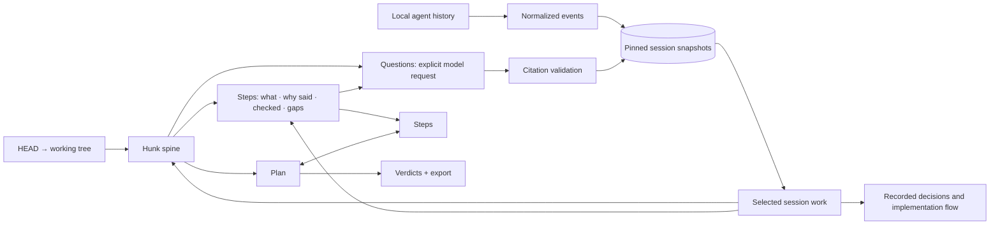

# Architecture

wy is a repo-first observer of coding-agent history, not the interface that launches
an agent. When the working tree is dirty the primary scope is the HEAD→working-tree
diff—the thing you are about to accept—and its **evidence** is the set of captured
sessions whose edit text matches it (newest first, each only if it explains hunks no
newer session already does, at most four). When the tree is clean, or nothing
matches, the latest session is the fallback and the plan says so. A hand-picked
session overrides the automatic choice until released. wy defaults to the latest known source-event date, never claims live-session
detection, and never *assigns* today's diff to a session: attribution is a textual
match between a hunk and a captured edit, or nothing.

## Hunk spine, steps, questions and verdicts

- `hunks.rs` parses each changed file's unified diff into hunks with current-tree
  line ranges and stable ids (file digest + ordinal, so an insertion above a hunk
  flags a verdict stale instead of orphaning it). `attribute` compares a hunk's added
  lines, whitespace-normalised, with the lines each captured edit introduced:
  complete writes contribute every line, patches only their additions. `matched` /
  `partial` / `none` is all the spine will ever claim. Lockfiles are `derived`.
- `steps.rs` segments the selected session into intent-sized steps from the pinned
  snapshot, offline. Boundaries: a new user request; an assistant message carrying a
  `WY_DECISION` record; an announcing message followed by edits to files disjoint
  from the current step; after a build/test run, an edit to a file the step has not
  touched. Repeated edits to one file (edit → failed test → fix) never split. Each
  step records verbatim reason statements (sentences with reason markers, or decision
  records), tentative rationale, nearby text, validation runs with outcomes, and
  gaps (shell commands that write files, truncated or unconfirmed captures, no
  checks). Hunk ↔ step links go through edit indices in both directions.
- `judgment.rs` builds a bounded packet (hunk diffs with limited context, steps,
  verbatim requests, assistant statements), sends it only on explicit request, and
  validates every question before display: cited hunks must exist in the diff;
  `recorded` requires a verbatim substring of a supplied statement whose step
  produced a cited hunk; `inferred` requires `inferred_from` hunks or steps and no
  quote; `unknown` carries nothing; `check` lines fall inside their hunk;
  self-reported alternatives cite a statement. Rejections are counted on screen.
  Ranking is consequence tier, then unknown before inferred before recorded. The
  scope key is repository + HEAD + exact hunk text + session snapshot + analysis
  version, so tree edits, commits and new session content all invalidate.
- `verdicts.rs` stores accept / push_back / unsure plus a note per question key
  (question text + sorted hunk ids), with a hash of each cited hunk at decision
  time. Staleness is detected by hash, flagged, never cleared. `export` writes the
  review in the reviewer's voice: push back, unsure, accepted, not reviewed, hunks
  in no question, then the agent's account for reference.

## Session work and decisions

- `history.rs` and adapters import repository-scoped Codex, Claude, pi and OpenCode
  histories, including supported edit inputs and tool outcomes. The capture is
  bounded to 20 sessions / 40 MB, with 20 MB per transcript.
- `history/recent.rs::records` extracts all supported edits from one saved session
  in source order, normalizes eligible paths and excludes known failures. The
  exported `session_edits` function is distinct from `recent_code`, which is a
  legacy bounded latest-edit-per-file projection.
- `session_work.rs` builds the selected session's file set, requests and edit
  sequence. It does not read current files to reconstruct historical content.
  `load` resolves and verifies the pinned snapshot identity and repository scope.
  `WorkSelection` optionally narrows discovery to normalized request ordinals within
  the immutable snapshot. `scoped` resolves selected turns and reindexes their edits;
  offline records and packet context share the same event-membership filter.
  Discovery rebuilds the selection from the pinned snapshot rather than trusting
  caller-provided edits or paginated reader documents.
  Packet assembly includes only the selected work's captured edits and public context,
  bounded by size and item count. Unsupported, unconfirmed or partial work is not
  repaired by borrowing today's code or another session's edits.
- `decisions.rs` groups self-reported records within the selected session and runs
  opt-in retrospective discovery. `data/decision-brief.schema.json` bounds responses
  to eight decisions. Validation requires captured-edit citations for every affected
  file, confines every evidence item to the selected tool/session/snapshot, and
  requires exact original assistant quotes for recorded rationale. Alternatives
  are assessments unless explicitly attributed. Structural validity does not prove
  semantic support.
- `decision_brief` artifacts include their evidence packet, scope kind and snapshot
  metadata. Session cache identity is repository + immutable session key + normalized
  request selection + analysis version. Current
  file hashes and Git HEAD are deliberately absent: commits and later edits do not
  invalidate historical explanations, while newly captured session content does.
- The earlier change-set assessment API remains separate for compatibility. It
  validates diff citations and current source hashes; the default TUI does not use
  that path for session decisions.

## User interface

`tui.rs` owns selected-session state, the hunk spine, steps, saved questions,
verdicts and the set of plan rows opened this run (`rebuild_lenses`, recomputed when
the review snapshot or selected session changes), reading history and cancellable
background jobs. The navigation is one row, **Plan / Steps**; there is no
session pane. `rebuild_lenses` picks the evidence, concatenates its sessions' edits
(each session at an offset), attributes hunks against that list, and merges steps
(`steps::merged`) so hunk ↔ step links hold across sessions. Everything that
is not the plan—steps, transcript, decision brief, commit history—sits under Steps.

`tui/plan_views.rs` renders both screens. Plan: four bordered boxes. *What changed*
is one row per step that produced code, titled in the imperative (announcing
preamble and reason clause stripped). *What to worry about* mixes formed questions
(consequence tier, said-status, verdict glyph) with offline gap rows (files no edit
explains, shell writes, derived files) and one state row that asks, retries or
re-forms. *Was it tested* summarises validation runs and names change groups with
none. *Progress* counts rows opened and verdicts given. Each row opens a detail:
change group (what, why in the agent's words, checked, worries, hunks), gap, tests,
or worry (domain why, chosen, said, hunks with `◄` markers, how to check, expert
view as assessment, verdict and note). Steps: one bordered box per step with Why /
Check / Gap / Plan rows and a link row title; step detail adds rationale, superseded
captured edits, the worries it raises and a link to the original conversation.

`tui/session_views.rs` renders the picker, chronological implementation flow,
captured edits and optional current-code comparison. Flow pages contain 20 edits;
repeated edits to a file are preserved. This is implementation chronology, not a
runtime call graph. Original conversation uses the existing paginated history
reader. `tui/code_view.rs` renders code without treating snippet-relative patch
coordinates as real file line numbers.

Background results are cached but cannot change the selected snapshot or interrupt
a draft, deep dive or evidence view. Session artifacts bypass current-source
freshness checks because they describe immutable captured work. Current comparisons
are explicitly read on demand and presented separately.

## Historical code versus current code

`session_work::compare` reads the current file only on the comparison action.
Whole-file equality/difference is reported only for a complete, successful final
captured full write. Comparisons use redacted text and ignore final newlines;
partial patches, truncation, unconfirmed execution and nonfinal writes report
comparison unavailable. A difference does not prove reversal, supersession,
authorship or that the change happened after the entire session ended. Missing or
unreadable current files are not automatically declared deleted.

Historical patches are never applied to today's files to invent earlier bases.
Saved code and context remain readable when current files or source transcripts
are deleted, provided the saved repository-scoped snapshot is still resolvable.

`/changes` exposes working-tree deltas with attribution unknown, without assigning
them to the selected session. `service.rs` still captures HEAD-to-working-tree
reviews for diagnostics and legacy tools. `reasoning.rs` provides separate opt-in
current-file explanations, explicitly distinct from session decision discovery.

## Evidence, storage and execution

- `history/provenance.rs` assigns original/secondary/unknown provenance at import.
  `history/origins.rs` resolves explicit original references within repository and
  fork boundaries. Summaries cannot establish original intent; hidden reasoning
  cannot be recovered. Content and provenance contribute to evidence identity.
- `history/attribution.rs` provides textual diff-to-edit overlap for diagnostics and
  legacy file readers, never proof of ownership or causality.
- `repository.rs` and `source.rs` read Git/source data without executing repository
  code. `security.rs` bounds and redacts content and restricts eligible paths.
- `agent.rs` runs only explicitly requested Codex/Claude assessments in temporary
  directories, with repository tools/configuration disabled, cancellation, timeouts
  and output limits. No model calls occur while opening, refreshing or navigating.
- `storage.rs` persists local JSON artifacts in SQLite and writes atomic review
  caches. Snapshots are pinned; later transcript changes do not rewrite them.
- `commits.rs` retrieves saved conversations through explicit or source-snapshot
  review associations, not inferred session ownership. Commit browsing does not
  replace the selected-session scope.

Local artifacts are unencrypted, redaction is best-effort, and there is no automatic
deletion policy. Tests establish behavior, not real-model accuracy or the two-minute
comprehension outcome; see [Evaluation](evaluation.md).
